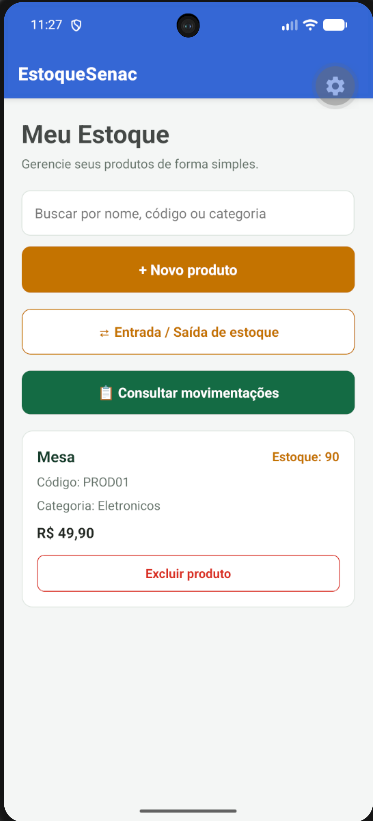
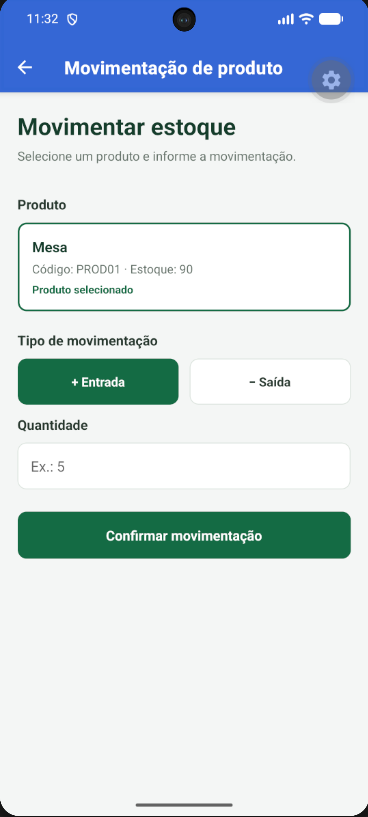
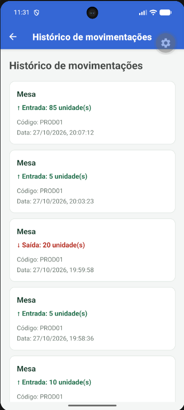

# 📦 EstoqueSenac

Aplicativo mobile para gerenciamento e controle de estoque, desenvolvido com React Native, Expo e SQLite

## ⚙️ Principais Funcionalidades


### Tela inicial


### Cadastro e consulta de produtos


### Movimentações de estoque



### Histórico de movimentações


## 🚀 Como executar o projeto

1. Clone o repositório:

   ```bash
   git clone https://github.com/jovsantos/EstoqueSenac-UC13.git
   ```

2. Acesse a pasta do projeto:

   ```bash
   cd EstoqueSenac-UC13
   ```

3. Instale as dependências:

   ```bash
   npm install
   ```

4. Inicie o Expo:

   ```bash
   npx expo start
   ```

## 👨‍💻 Autor

**João Vitor dos Santos Ferreira**

Projeto acadêmico desenvolvido no curso Técnico em Análise e Desenvolvimento de Sistemas (ADS) — SENAC.
